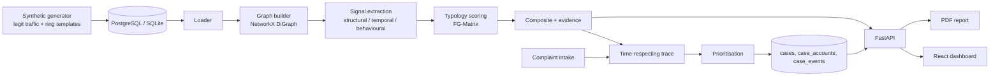

# Architecture

## Detection pipeline

1. **Graph**: aggregated directed graph (edge = src→dst with count/total/first/last); raw transactions are kept for temporal logic.
2. **Signals** (all 0..1, per account): inflow spike, age-vs-volume mismatch, burst concentration, FIFO pass-through ratio + dwell time, pass-through chain depth, split burst (near-equal amounts in 24h), fed-by-single-inflow, threshold hugging, time-ordered value-preserving cycles, withdrawal ratio/concentration, dormancy gap, creation clustering on shared KYC device/address, legitimacy (active days, recurring counterparties). Betweenness and PageRank are computed for context.
3. **Typology score** = weighted sum of signals × optional gates × (1 − 0.85·legitimacy).
4. **Composite** = top typology + 0.15 × runner-up. Alert at ≥ 0.50; typology label at ≥ 0.45.

## Trace

From the origin transfer, follow outbound transfers/withdrawals within 12 h of funds arriving and ≥ max(₹1,000, 2.5 % of first inflow). Accounts with legitimacy ≥ 0.8 become boundary nodes. Re-entry into a visited account marks a loop. Output: nodes (hop, inflow/outflow/withdrawn/retained), edges, stats (depth, cash-out, recoverable, money span).

## Case lifecycle

`open → investigating → funds_frozen → closed`. Freeze is simulated: account status flips, estimated funds held are logged to `case_events`. Notes and status changes share the same audit trail, which feeds the PDF.

## Data model

accounts, transactions, complaints, cases (analysis JSON), case_accounts, case_events, ground_truth (evaluation only, never read by detection), meta. One portable schema for PostgreSQL and SQLite.
